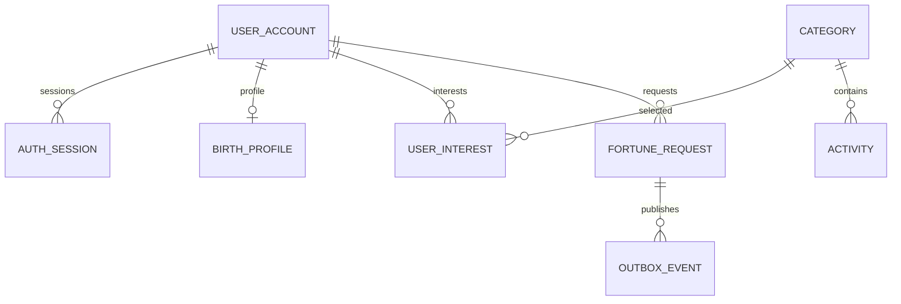

# 운빨 백엔드 DB 설계

> 설계안 v0.1 · 논리 구조와 핵심 제약만 정리했다. Flyway·엔티티·실제 테이블은 구현 단계에서 만든다.

## 기존에서 가져갈 도메인

회원, 사주 기본정보, 달력·시주 기준표, 비장술 조합·해석, 카테고리·이미지, 추천별·열람 이력이 핵심이다. 기존 MySQL 테이블을 그대로 복사하지 않고 PostgreSQL/Mongo 소유권에 맞춰 재구성한다. 실제 DB·기준표·해석 원문 seed는 아직 확보하지 않았다.

## PostgreSQL은 fortune-service만 접근

모든 내부 ID는 UUID, DB 시각은 timestamptz/UTC다. 문자열 코드는 코드 테이블로 검증한다. 아래 UQ는 unique, FK는 같은 PostgreSQL 내부 외래 키다.

| 테이블 | 핵심 필드·초기값 | 제약·관계 |
|---|---|---|
| user_account | id, login_id, password_hash, nickname, created_at | PK id, UQ 정규화 login_id, 비밀번호 원문 저장 금지 |
| auth_session | id, user_id, refresh_token_hash, expires_at, revoked_at(null) | FK user, 토큰 해시·만료·폐기. 원문 refreshToken 저장 금지 |
| birth_profile | user_id, birth_year/month/day, calendar_type, leap_month(false), birth_time_code(null), solar_birth_date, calendar_version, profile_version(1) | PK/FK user_id. 시간 미상은 null. 입력과 정규화 날짜·계산 기준 버전 구분 |
| calendar_day | data_version, solar_date, lunar_year/month/day, leap_month, year/month/day 사주 코드 | PK(version, solar_date), UQ(version, 음력 년월일, 윤달) |
| birth_time_rule | data_version, day_stem, time_code, time_stem/branch | PK(version, day_stem, time_code) |
| category / activity | code, name, sort_order, enabled, image_url(null); activity.category_code | activity→category FK. 1차 대표 이미지 한 개, 복수 이미지 필요 시 분리 |
| user_interest | user_id, category_code | 복합 PK, 두 FK. 쉼표 문자열 저장 대신 관계 분리 |
| fortune_request | id, user_id, type, activity_code(null), effective_date, profile_version, rule/content_version, normalized_input(jsonb), status(PENDING), result_id/failure_code/completed_at(null), request_hash, idempotency_key, created_at | UQ(user_id, idempotency_key). 입력 스냅샷은 생성 후 불변, type별 activity 필수 여부 CHECK |
| outbox_event | event_id, request_id, type, payload, status(PENDING), attempts(0), next_attempt_at, published_at(null) | PK event_id, FK request, payload는 참조·상태만 허용 |
| inbox_event | event_id, processed_at | PK event_id로 중복 완료 이벤트 차단 |

`user_account.login_id`는 기존 대문자 정규화를 유지하는 안이며 API·DB 모두 같은 정규화를 적용한다. birth_profile의 입력 날짜는 음력도 표현할 수 있게 정수 필드로 저장하고, 유효한 달력 행과 대조한 뒤 solar_birth_date를 정한다. 지원 연도·출생시간 코드·윤달 처리는 실제 기준표 범위로 제한한다.

## MongoDB는 interpretation-service만 접근

| 컬렉션 | 핵심 필드 | 불변식·인덱스 |
|---|---|---|
| rule_sets | version, 비장술 조합·항목별 우선순위·추천 시간 규칙 | UQ version, 검증된 새 버전 발행 후 기존 버전 보존 |
| interpretation_templates | content_id, version, 조합 코드, summary, character_code, publication_status | UQ(content_id, version), 개인 결과와 공개 원문 분리 |
| interpretation_results | _id=requestId, effective_date, profile_version, rule/content_version, 결과·날짜/시간 목록, status, completion_delivery | 같은 requestId 결과 중복 생성 금지. 완료 이벤트 준비를 결과와 함께 저장 |

SQL의 `fortune_request.result_id`는 Mongo 결과를 가리키는 논리 참조이며 DB 간 FK가 아니다. 결과에는 생일·이름을 반복 저장하지 않는다. normalized_input의 사주 코드와 해석 결과도 개인정보로 취급한다.

## 조회·동시성·수명

- 요청 목록 인덱스 `(user_id, created_at DESC, id DESC)`, 재처리 후보 `(status, created_at)`, Outbox `(status, next_attempt_at)`를 실제 쿼리와 함께 검증한다.
- `PENDING → SUCCEEDED/FAILED`를 조건부 갱신하고 result_id는 SUCCEEDED에만 설정한다. 외부 HTTP/Kafka를 DB 트랜잭션 안에서 기다리지 않는다.
- Kafka 완료 처리의 Inbox 삽입과 요청 상태 갱신은 같은 PostgreSQL 트랜잭션이다. 처리 도중 종료되면 둘 다 롤백하거나 둘 다 커밋되어야 한다.
- 추천별·열람은 후속 `usage_wallet/usage_ledger/referral`로 분리한다. ledger의 request_id를 unique로 하고 잔여량 조건부 차감과 이력 저장을 한 트랜잭션으로 묶는다. 기존 초기 횟수를 새 정책으로 자동 확정하지 않는다.
- refresh 세션 만료·폐기는 인증 단계에서 구현한다. 개인정보·결과·이벤트 이력의 보관 기간과 탈퇴 삭제 전파는 해당 기능 계약에서 확정한다.

Redis는 원본이 아닌 TTL 캐시, Elasticsearch는 공개 콘텐츠만 담는 재생성 가능한 인덱스다. 이 두 저장소에 회원·생일·개인 결과를 검색 가능한 원본으로 만들지 않는다.

## 이관 전에 확인

달력 데이터의 출처·윤달·지원 범위, 시주 코드 정의, 비장술 조합·해석·이미지 사용 범위, 기존 이용 이력 이관 여부를 먼저 확인한다. 초기 개발은 합성 fixture로 하며 실제 계산 정확성·운영 데이터 이관 완료로 표현하지 않는다. 상세 컬럼 타입·필수/null·기본값·Java/JSON 매핑 표와 DDL은 기능별 착수 시 함께 검토한다.
