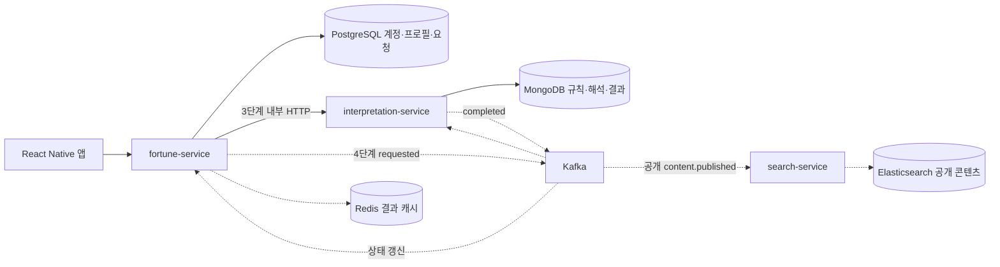

# 운빨 백엔드 아키텍처 설계

> 설계안 v0.1 · [Plan](../../01-plan/features/backend-renewal.plan.md) · 목적은 기존 기능 복원과 검증 가능한 단계별 확장이다.

## Context Anchor

기존 사주·비장술 기능을 먼저 복원하고 비동기·캐시·검색을 단계적으로 검증한다. 데이터 출처와 결과 정확성 기준은 구현 전 확인하며 이번 산출물은 실행 코드가 아닌 설계다.

## 현재와 선택

기존은 React Native 앱 → Spring Boot 2.7/Java 11 단일 백엔드 → MySQL/JPA·Querydsl 구조이며 Redis·JWT·배치/FCM 코드가 있다. 리뉴얼에는 이미 Java 21/Boot 3.5와 세 서비스가 준비되어 있으므로 이 경계를 유지한다. 원본 빌드·운영 동작은 이번에 실행하지 않았다.

| 대안 | 장점·비용 | 선택 |
|---|---|---|
| 단일 백엔드로 재통합 | 트랜잭션·실행 단순, 서비스 간 장애 학습 감소 | 비교 대안 |
| 세 서비스를 처음부터 전부 Kafka로 연결 | 목표 구조를 바로 경험, 디버깅·복구 부담 큼 | 첫 구현에는 적용하지 않음 |
| 세 서비스 유지, 업무 흐름 후 비동기 전환 | 도메인과 통신 문제를 나눠 검증 | 제안안 |

실선 HTTP·도메인 저장도 현재는 설계다. Kafka·캐시·검색은 후속 단계이며 DB 직접 조회·공유 엔티티·서비스 간 Gradle 의존성을 만들지 않는다.

## 서비스 책임

| 서비스 | 소유·책임 |
|---|---|
| fortune | 인증·프로필·관심/카테고리·달력 정규화·요청 상태·열람 정책. 모든 본인 결과 조회 권한 확인 |
| interpretation | 비장술 조합/우선순위·해석 템플릿·계산 결과. 입력 코드를 받아 계산하고 Mongo에 저장 |
| search | 공개된 콘텐츠의 검색 projection·재색인. 개인 결과는 색인하지 않음 |

fortune은 요청 시 정규화된 사주 코드·기준일·항목·버전의 불변 스냅샷을 보관한다. interpretation은 서비스 인증을 적용한 내부 HTTP로 스냅샷을 읽고, fortune은 내부 HTTP로 Mongo 결과를 조회한다. 내부 API는 사용자 토큰으로 호출할 수 없도록 별도 audience/scope를 검증하며 외부에 공개하지 않는다. 상세 내부 계약·서비스 자격 증명은 3단계 착수 때 확정한다.

## 3단계 동기 처리부터

달력·규칙·해석 버전은 검증한 릴리스 설정으로 고정하고, interpretation이 같은 버전의 데이터를 제공하는지 확인한다. 서버가 임의로 최신 규칙을 섞어 사용하지 않는다.

1. fortune이 소유권·입력·멱등 키를 검사하고 PENDING 요청과 입력 스냅샷을 DB에 커밋한다.
2. interpretation에 requestId로 처리를 요청한다. 네트워크 호출 중 PostgreSQL 트랜잭션을 유지하지 않는다.
3. interpretation이 규칙·템플릿 버전을 고정해 Mongo에 requestId 기준 결과를 한 번 저장한다.
4. fortune이 결과 존재를 확인한 뒤 SUCCEEDED 또는 확정 실패의 FAILED로 전이한다. 저장 후 응답 유실은 같은 requestId로 조회·재시도해 정합성을 회복한다.

202는 접수된 자원의 식별자를 반환하는 계약이며 이 단계에서는 HTTP 처리가 응답 전에 끝날 수 있다. 사용자 재전송·복구 작업은 PENDING 요청을 같은 ID로 재구동할 수 있어야 한다. 내부 HTTP timeout 제안 5초, 불확실한 결과를 즉시 FAILED로 확정하지 않는다. 자동 복구 스캔의 주기·한도는 구현 시 명시한다.

## 4단계 Kafka와 실패 처리

- PostgreSQL에서 요청+Outbox를 같은 트랜잭션으로 저장한다. 발행 성공 표시 전 종료되면 같은 eventId로 재발행한다.
- `fortune.requested.v1` → interpretation 저장 → `fortune.completed.v1` → fortune 상태 갱신. key=requestId, envelope는 eventId/requestId/schemaVersion/occurredAt와 필요한 상태·버전·오류 코드만 담는다.
- 이벤트에 생일·이름·사주 입력 코드·개인 운세 원문을 넣지 않는다. 처리 입력과 결과는 인증된 내부 HTTP로만 전달한다.
- Mongo 결과 문서에 완료 이벤트 발행 대기 정보를 함께 저장하는 방식을 제안한다. 결과 저장과 이벤트 준비가 분리되어 누락되지 않게 하고, 중복 완료는 PostgreSQL Inbox·조건부 상태 전이로 무시한다.
- 완료 소비자는 Inbox eventId 삽입과 요청의 조건부 상태 갱신을 하나의 PostgreSQL 트랜잭션으로 커밋한다. Inbox만 기록한 채 상태 갱신이 유실되지 않도록 한다.
- 일시 장애는 최대 3회 재시도 제안, 초과·독성 메시지는 해당 `.DLT`로 격리한다. DLT 적재만으로 업무 상태를 FAILED로 바꾸지 않고 실패 이벤트/대사로 종료를 확인한다. 운영 재처리는 기존 결과·처리 이력과 대조한다.

## 캐시·검색·관측은 이후

Redis 결과 캐시는 `fortune:result:v1:{requestId}`, TTL 5분을 초기 제안으로 둔다. 권한을 먼저 확인하고 조회하며 캐시 장애는 interpretation HTTP로 fallback한다. 결과 삭제·재처리 시 키를 지우고 TTL만으로 무효화를 대신하지 않는다.

Elasticsearch는 공개 템플릿 발행 이벤트만 소비한다. Kafka·내부 HTTP는 traceId로 연결하되 개인정보·토큰·운세 원문을 로그에 기록하지 않는다. Outbox·멱등·DLQ·복구는 장애 실험 이후에만 완료로 표시한다.

## 구현 조직과 검증

서비스 내부는 기능별 패키지 아래 `web/application/domain/infrastructure`로 나누되 비어 있는 계층을 미리 만들지 않는다. 개인 결과 소유권·날짜 경계·동시 요청·HTTP 응답 유실·Kafka 중복·프로세스 종료를 기능별 테스트/실험으로 검증한다. 이 문서 자체는 실행 검증 결과가 아니다.
